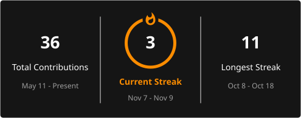

# 💫 About Me

👋 Hi, I'm Bhanupriya N R <br>
🎓 3rd-year Computer Science Engineering student @ GECH<br>
💻 Currently learning Python Full Stack Web Development git & github <br>
📫 Reach me: [bhanupriya7540@gmail.com](mailto:bhanupriya7540@gmail.com)

---

# 💻 Tech Stack


---

# 📊 GitHub Stats

<p align="left">
  
  
</p>

---

# 🔥 GitHub Contribution Streak

<p align="left">
  
</p>

---

## 🏆 GitHub Trophies

<p align="left">
  
</p>

---

### 🔝 Top Contributed Repo

<p align="left">
  
</p>

---

<h2 align="left">👀 Profile Visitors</h2>

<p align="left">
  
</p>


⭐ Thanks for visiting my profile!

<!-- Proudly created with GPRM (https://gprm.itsvg.in) -->

<!--
**bhanurgowda12/bhanurgowda12** is a special repository
because its README.md appears on your GitHub profile.
-->
```
